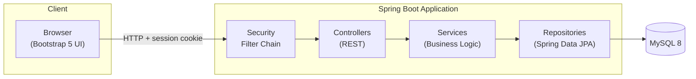
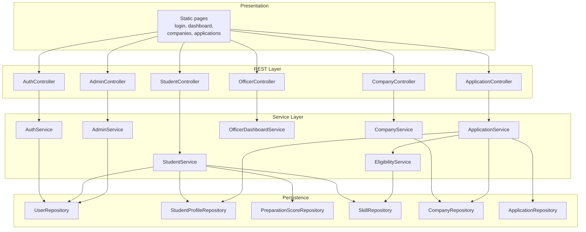
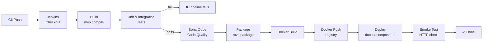
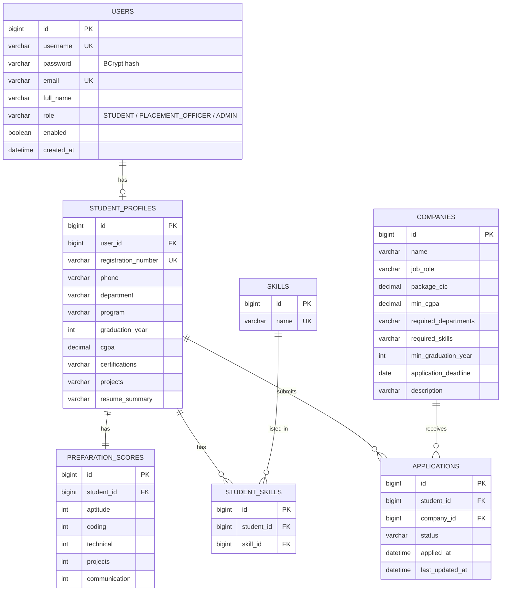
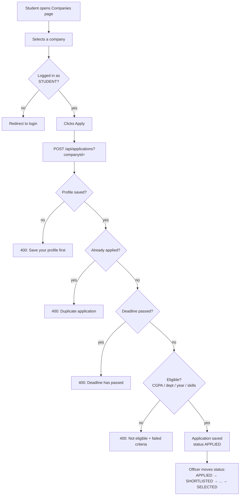
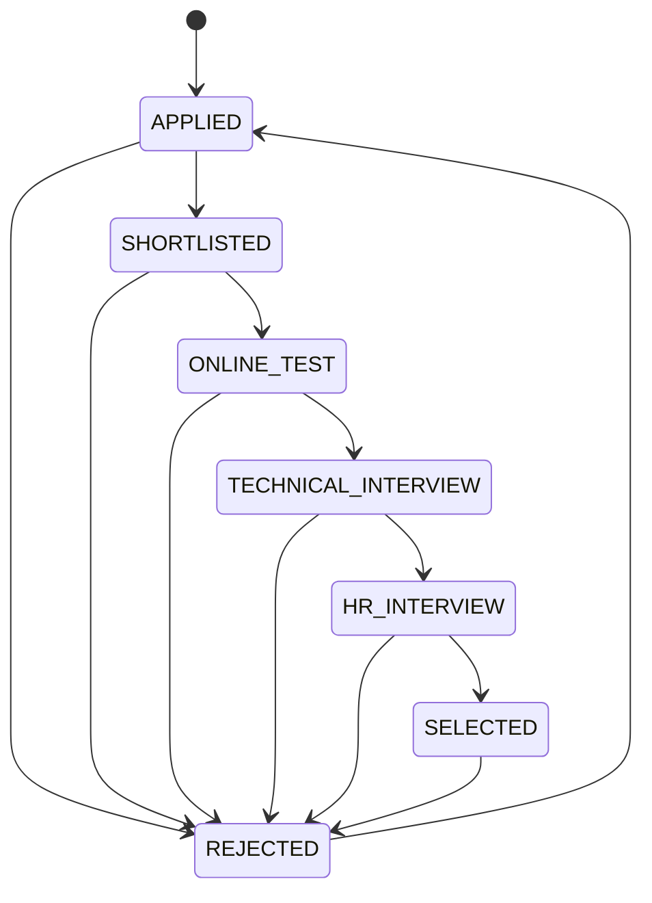

# Architecture

## 1. High-Level System Architecture

- The browser talks to REST endpoints; static HTML/JS pages are served by Spring Boot from `static/`.
- Spring Security authenticates every request and enforces role rules before controllers run.
- All business rules live in the service layer; controllers only translate HTTP ↔ DTOs.

## 2. Application Component Flow

## 3. CI/CD Pipeline

## 4. Database ER Diagram

## 5. Application Workflow (Apply for a Company)

## 6. Application Status Flow

